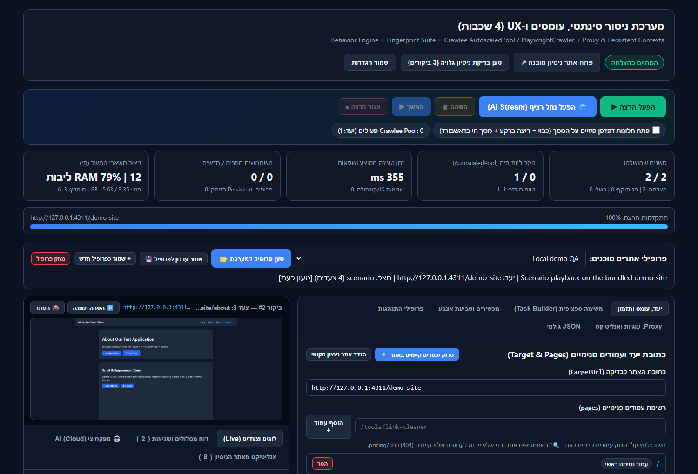

# Traffic Engine — Self-Hosted Browser QA

Record a signup and replay it in a real Playwright browser. With the inbox service connected, Traffic Engine can open a fresh inbox, fill the registration form, wait for the verification email and enter the one-time code. Watch each step from the dashboard and chat with the AI commander while the run is active.



## Features

| Area | What the dashboard supports |
| --- | --- |
| Runs engine | Concurrent Playwright sessions, device and persona variation, scheduled start windows, live status and pause, resume, and stop controls. |
| Journey recorder | Capture and replay navigation, form interactions, waits and other steps. Inspect the DOM and audit ad surfaces on authorized sites. |
| Inbox flows | Create a live inbox through the configured email service and fill email or one-time code fields during an authorized test. |
| Proxy layer | Assign a proxy per visit, optionally filter the pool by country, and check reachability and latency before a run. |
| Reports | Review live logs and per-session step outcomes. Download a summary PDF when Chromium can render it. |
| AI commander | Optional provider-backed chat and run review. Configured integrations can supply guidance or propose configuration changes. |

[Live run log](docs/img/live-run-log.png) · [Generated PDF report page](docs/img/generated-pdf-report.png)

## Quickstart

Use a supported Node.js LTS release on Windows. From the repository root in PowerShell:

```powershell
npm install
npm --prefix dashboard install
npx playwright install chromium firefox webkit
Copy-Item config.example.json config.json
```

Edit `targetUrl` in `config.json` to point to a site you own or are authorized to test. The example points to the dashboard's local demo site. Run `start-dashboard.bat` and open [http://127.0.0.1:4310](http://127.0.0.1:4310).

## Test a signup with a live inbox

If you have a commercial HirePulse Email API key, configure it in the dashboard process environment as `HIREPULSE_EMAIL_API_KEY`, then restart the dashboard. The [local email status endpoint](http://127.0.0.1:4310/api/email/status) reports whether a key is configured and which credential mode is selected. This check makes no inbox request.

1. Use the journey recorder on a test site you control. Record the email field, the registration button, the verification-code field and the confirmation button.
2. Review the recording. Sensitive fields such as passwords are blank in recorded steps. Supply test values in the local configuration before replay. The recorder uses an OTP placeholder for recognized code fields.
3. Use the `fill_email` and `fill_otp` actions if the site uses selectors that automatic detection misses.
4. Add a final assertion for the success text or destination URL. A code entered in the page is evidence of a completed step. The assertion checks whether the site accepted it.

An inbox is created when a visit reaches its first inbox step. The same visit reuses that inbox. An expired inbox, a missing code or a credit error fails the affected step. The [public service catalog](https://gethirepulse.xyz/v1/email/catalog) describes x402 access. The dashboard uses a bearer API key. Ask the service operator for a compatible key before depending on live inboxes.

For an existing owner-pilot installation, set `HIREPULSE_OWNER_PILOT_FILE` to your existing local credential file or supply `HIREPULSE_OWNER_PILOT_TOKEN` in the process environment.

## Bring your own AI key

Set `OLLAMA_API_KEY` for Ollama Cloud or `ULLM_API_KEY` for UncensoredLLM in the dashboard process environment. Restart the dashboard and select the provider and model in its AI settings. The local advisor is available without a cloud key. Cloud usage is billed through the provider account.

## Proxies

The repository ships **no proxies**. Supply your own list in `proxies.txt` at the repository root, with one entry per line in the form `http://<user>:<pass>@<host>:<port>`. Git ignores this file. Never commit it.

When enabled, the proxy layer can filter candidates by country and precheck reachability and latency. It selects a proxy for each visit using round-robin or random rotation. An optional static fallback pool can be kept in the ignored `proxies-fallback.txt` file.

## Configuration reference

| Key | Purpose |
| --- | --- |
| `targetUrl` | Base HTTP(S) URL for the site under test. |
| `pages` | Navigation paths used by the browsing engine. |
| `visitCount` | Number of sessions planned for a run. |
| `minConcurrency` | Baseline parallelism for the autoscaled engine. |
| `concurrency` | Upper bound on simultaneous sessions. |
| `firstPagePriority` | Weighted preference for the first entry in `pages`, as a percentage. |
| `sessionTimeoutMs` | Time budget for a session in milliseconds. |
| `pageMinMs` | Minimum page dwell time for flows that use it, in milliseconds. |
| `headless` | Whether the browser launches without a visible window. |
| `engineMode` | Selects the Playwright execution and scheduling mode. |
| `taskMode` | Chooses browsing behavior, an explicit scenario, or a hybrid run. |
| `referrerMode` | Selects the referrer policy applied by the runner. |
| `taskSteps` | Ordered step objects for scenario playback. |
| `keepBrowserOpenMs` | Delay before browser context cleanup, in milliseconds. |
| `interVisitDelayMs` | Requested pacing delay between visits, in milliseconds. |
| `snippet` | Optional initialization JavaScript for browser pages. |
| `schedule` | Optional local-time execution window. |
| `devices` | Relative weights for the available browser and device profiles. |
| `personas` | Session presets that vary scrolling, interaction and dwell time. |
| `proxy` | Enables proxy assignment and configures pool selection and country filtering. |
| `stealthMode` | Selects the browser launch profile. |
| `resourceMode` | Controls browser resource handling or selects a CDP backend. |
| `waves` | Optional run planning settings for grouping and varying scenario sessions. |
| `ai` | Optional AI provider, models, guidance and orchestration settings. |
| `sessionPersistence` | Controls local profile reuse and the size of the pool. |
| `adSafety` | Safety switches that control overlay dismissal, pop-under handling, click filtering and a telemetry header. |

See [the technical specification](docs/SPEC.md) for the run pipeline, API and scenario step types.

## Ethics and limitations

Operators are responsible for complying with the terms of service, robots directives and advertising policies of any site they automate. The authors provide this software as-is for testing, QA and monitoring of sites the operator owns or is authorized to test.

## License

[MIT](LICENSE)
